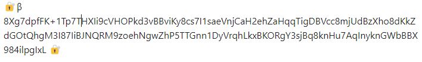
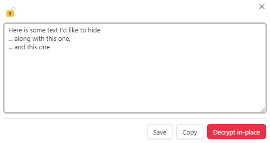

# In-Place Encryption

This feature lets you encrypt a selected text within your note.

Inline password hints cannot contain 💡 or 🔐, because these characters delimit
the encrypted block and its hint.

## To Encrypt Selected Text

### Option 1: Use the Command Palette

1. Go to **Files** by clicking the **Files** icon . 
2. Create a new note by clicking the **New note** icon  or select an existing one.
3. Select a text to encrypt. 
    > Note: A partial selection will be expanded to include the whole line if the **Expand selection to whole line** setting is enabled (see the [Settings](settings.md) section).
4. Open the **Command palette** by clicking the **Open command palette** icon .
5. Type or scroll to **Encrypt selection**, then select it.
6. Enter and confirm a password. You can add an optional password hint.
7. Click **Confirm**.

### Option 2: Use the Encrypt selection Ribbon Button

1. Go to **Files** by clicking the **Files** icon . 
2. Create a new note by clicking the **New note** icon  or select an existing one.
3. Select a text to encrypt. 
    > Note: A partial selection will be expanded to include the whole line if the **Expand selection to whole line** setting is enabled.
4. Click the **Encrypt selection** ribbon button.
5. Enter and confirm a password. You can add an optional password hint.
6. Click **Confirm**.

## To Reveal or Decrypt Selected Text 

### Option 1: Use the Command Palette

1. Go to **Files** by clicking the **Files** icon . 
2. Select the note with the encrypted text. 
3. Place your cursor anywhere on the encrypted text.
   
4. Open the **Command palette** by clicking the **Open command palette** icon .
5. Type or scroll to **Decrypt**, then select it.
6. Enter the correct password. 
   > Note: Your previously used password is filled in by default (you can change this in the plugin settings).
7. Your decrypted text appears in a dialog window. You can save it, copy the text, or click **Decrypt in-place** to decrypt the text directly in the note.
   
   
### Option 2: Use the Decrypt at Cursor Ribbon Button

1. Go to **Files** by clicking the **Files** icon . 
2. Select the note with the encrypted text. 
3. Place your cursor anywhere on the encrypted text.
   
4. Click the **Decrypt at Cursor** ribbon button.
5. Enter the correct password. 
   > Note: Your previously used password is filled in by default (you can change this in the plugin settings).
6. Your decrypted text appears in a dialog window. You can save it, copy the text, or click **Decrypt in-place** to decrypt the text directly in the note.
   

### Reading View

Click a visible 🔐 marker to reveal its decrypted text. This popup is read-only and offers **Copy**.
To edit and save encrypted text, switch to the editor and use the **Decrypt** command.

## Saving Edited Text

In the editor's decrypted-text dialog, **Save** re-encrypts your edits using the
same password, hint, and reading-view marker visibility. Legacy inline blocks
are upgraded to the current encryption format when saved this way.
**Decrypt in-place** replaces the block with plaintext in the note.

In the password dialog, Enter moves through the password, confirmation, and
hint fields as applicable. Moving to the hint field does not accept the dialog;
closing it before final confirmation discards the result.
