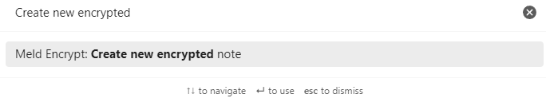
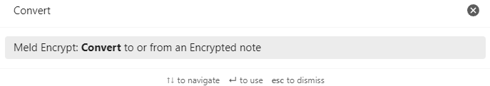

# Whole Encrypted Notes

This feature opens a text window and saves your note to an encrypted `.mdenc` file.

## To Create a New Encrypted Note

### Option 1: Use the Command Palette

1. Open the **Command palette** by clicking the **Open command palette** icon .
2. Type or scroll to **Create new encrypted note**, then select it.
   
3. Enter and confirm a password. You can add an optional password hint. 
4. Click **Encrypt**.
5. Write your note in the text window. 
6. Click the **Lock & Close** icon  when done. 

### Option 2: Use the Ribbon Icon

1. Click the **New encrypted note** icon. 
2. Enter and confirm a password. You can add an optional password hint. 
3. Click **Encrypt**.
4. Write your note in the text window. 
5. Click **Lock & Close**  when done.

## To View or Edit an Encrypted Note

1. Go to **Files** by clicking the **Files** icon . 
2. Select the file with your encrypted note. 
3. Enter the correct password if prompted.
4. Click **Decrypt**. A remembered password may unlock the note automatically.

## To Change an Encrypted Note's Password and Hint

1. Go to **Files** by clicking the **Files** icon .  
2. Select the file with your encrypted note. 
3. Enter the correct password. 
4. Click the **Change password** action  in the note view, or right-click inside the open encrypted note and select **Change password**.
5. Enter and confirm a new password and an optional password hint.
6. Click **Encrypt**.

The **Change password** and **Lock & close** actions are also available when
right-clicking the active encrypted note's file in **Files**. They are shown
only when that file matches the active encrypted view.

## To Encrypt or Decrypt an Existing Note

**Decrypt note** and conversion of an encrypted note write plaintext that may be synced or backed up. Opening an encrypted note to read or edit it keeps its saved text encrypted.

### Option 1: Use the Right-Click Menu

1. Go to **Files** by clicking the **Files** icon . 
2. Right-click the Markdown note you want to encrypt, or the encrypted note you want to convert to plaintext.
3. Select **Encrypt note** or **Decrypt note**.

### Option 2: Use the Ribbon Icon

1. Go to **Files** by clicking the **Files** icon .
2. Select the file with your encrypted note. 
3. Click the **Convert to or from an Encrypted note** icon  to encrypt or decrypt the file.

### Option 3: Use the Command Palette

1. Open the **Command palette** by clicking the **Open command palette** icon .
2. Type or scroll to **Convert to or from an Encrypted Note**, then select it.
   
